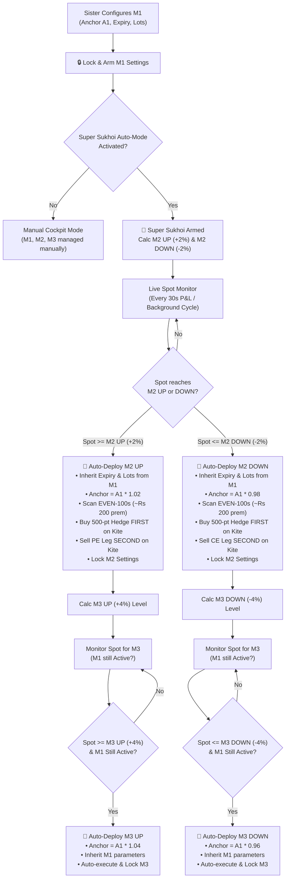

# 🦅 SUPER SUKHOI AUTOMATION BLUEPRINT (V7.0) — ZERODHA SISTER EDITION
## **Autonomous Multi-Tier Directional Laddering Engine for Zerodha Kite**
### *Target System: Zerodha Kite Option Selling App (Bharat Systems — Chhoti Bahan Edition)*
### *Document Version: 7.0.0 | Date: 26-Oct-2026*

---

## 📌 1. EXECUTIVE SUMMARY & ARCHITECTURAL FOUNDATION

### 1.1 Non-Invasive Superstructure on Zerodha Kite
The **Super Sukhoi Engine (V7.0)** is an autonomous supervisory layer built over the mature, stable **Directional M-Unit Architecture** (`M1`, `M2`, `M3`) running on Zerodha Kite:
- **Zero Core Tampering**: Existing M-Unit execution routines (`inspect_m_unit_candidates`, `deploy_or_update_m_unit`), OS positional spreads, and Weekly ST (W1) systems remain 100% untouched.
- **Manual vs Autonomous Parity**: Sister can trade M1, M2, and M3 manually via the Cockpit OR activate **Super Sukhoi Auto-Mode** with a single click.
- **True Fire-and-Forget Scaling**: Once sister sets up `M1` with an Anchor Price ($A_1$), Expiry Date, and Lots, the engine continuously tracks live Nifty Spot and autonomously deploys `M2` and `M3` as the market trends.

---

## 🎯 2. MATHEMATICAL FORMULATION & TRIGGER BANDS

Super Sukhoi establishes strict mathematical trigger thresholds derived directly from the **M1 Anchor Price ($A_1$)**:

$$\Large A_1 = \text{Sister-Defined M1 Master Anchor Price}$$

### 2.1 Laddering Threshold Matrix

| Unit Tier | Direction | Formula | Example ($A_1 = 22,650$) | Action on Spot Breach |
|---|---|---|---|---|
| **Tier 1 (Up)** | `M2 UP` | $A_1 \times 1.020$ (+2.00%) | **₹23,103.00** | Auto-spawn `M2`, Anchor = ₹23,103, Deploy Bull Put Spread |
| **Tier 1 (Down)** | `M2 DOWN` | $A_1 \times 0.980$ (-2.00%) | **₹22,197.00** | Auto-spawn `M2`, Anchor = ₹22,197, Deploy Bear Call Spread |
| **Tier 2 (Up)** | `M3 UP` | $A_1 \times 1.040$ (+4.00%) | **₹23,556.00** | Auto-spawn `M3`, Anchor = ₹23,556, Deploy Bull Put Spread |
| **Tier 2 (Down)** | `M3 DOWN` | $A_1 \times 0.960$ (-4.00%) | **₹21,744.00** | Auto-spawn `M3`, Anchor = ₹21,744, Deploy Bear Call Spread |

> **Key Rule**: Once a tier triggers (e.g., `M2 UP`), the opposing trigger (`M2 DOWN`) is automatically locked out for that tier, ensuring clean unidirectional scaling without cross-contamination.

---

## 🔄 3. STATE MACHINE & LOGIC FLOWCHART



---

## 🛡️ 4. STOP-LOSS OVERHAUL: DECOUPLING & OPTIONALITY INVARIANT

### 4.1 Diagnosis of 25% SL Problem
- **Problem**: Intraday market oscillations cause temporary premium expansion. Cutting SELL legs at $+25\%$ locks in unnecessary losses right before market recoils.
- **Zerodha Protective Armor Reality**:
  - The SELL leg is already protected by an **active 500-point OTM Hedge Helmet** (`HEDGE_BUY`).
  - Maximum tail risk is strictly capped by the spread width ($500 \text{ pts} - \text{Credit Collected}$).
  - Intraday directional continuation is audited systematically at **14:57 / 15:00 IST EOD**.

### 4.2 Resolution: Optional SL (Disabled by Default in Zerodha OS)
1. **Configurable Toggle**: `m_stoploss_mode` (`"DISABLED"` / `"25% DEFAULT"`).
2. **Default State**: Set to **`DISABLED`** in Zerodha OS.
3. **Execution Guard**: If `m_stoploss_mode == "DISABLED"`, `pnl_engine.py` skips the 25% intraday trigger exit.
4. **Peaceful Hold**: Legs are held peacefully throughout the trading session to harvest full natural decay, governed by the 500-pt hedge helmet and 14:57 IST EOD anchor continuation decision.

---

## 🔇 5. MARKET CALENDAR & OFF-HOURS SILENCE GUARD

Before checking broker session validation or sending alerts:
```python
def is_market_session_active() -> bool:
    now = datetime.datetime.now(IST)
    if now.weekday() >= 5:  # Saturday or Sunday
        return False
    if not ("09:00" <= now.strftime("%H:%M") <= "15:30"):
        return False
    if now.strftime("%Y-%m-%d") in NSE_HOLIDAYS_2026:
        return False
    return True
```
If market is closed or on holiday, the engine enters peaceful sleep with zero alert spam.

---

## 🖥️ 6. USER INTERFACE & TELEMETRY RADAR (PORT 9007)

```
┌────────────────────────────────────────────────────────────────────────┐
│ 🦅 SUPER SUKHOI AUTONOMOUS LADDERING CONTROL                           │
├────────────────────────────────────────────────────────────────────────┤
│ 🟢 M1 Active (Anchor ₹22,650.00) • Scanning Spot for M2 UP (≥ ₹23,103) │
│                                                                        │
│ [ 🚀 ACTIVATE SUPER SUKHOI AUTO-MODE (M2/M3 FIRE-AND-FORGET) ]         │
│                                                                        │
│ ┌───────────────────────┬───────────────────────┬────────────────────┐ │
│ │ M1 Seed Anchor        │ M2 Trigger (±2.00%)   │ M3 Trigger (±4.00%)│ │
│ │ ₹22,650.00 (Locked)   │ UP:   ₹23,103.00 (SB) │ UP:   ₹23,556 (SB) │ │
│ │ 2 Lots | 23-NOV-2026  │ DOWN: ₹22,197.00 (SB) │ DOWN: ₹21,744 (SB) │ │
│ └───────────────────────┴───────────────────────┴────────────────────┘ │
│                                                                        │
│ 🛡️ Compulsory Protective Armor: 100% ACTIVE (±500 pts Helmet)           │
│ ✂️ Midday 25% Stop-Loss: OFF (Harvest Natural Theta Decay)             │
└────────────────────────────────────────────────────────────────────────┘
```

When sister clicks `[ 🚀 ACTIVATE SUPER SUKHOI AUTO-MODE ]`:
A 2-step confirmation modal appears:
> **⚠️ CONFIRM SUPER SUKHOI ACTIVATION**  
> *"Are you sure you want to activate Full Autonomous Super Sukhoi Mode? The engine will continuously monitor Nifty Spot and autonomously deploy M2 and M3 at ±2.00% and ±4.00% without manual intervention."*  
> `[ 🚀 YES, START SUPER SUKHOI NOW ]` | `[ ❌ Cancel ]`

Once activated, sister can peacefully close her laptop screen or do her daily tasks; Zerodha OS handles the scaling automatically!
